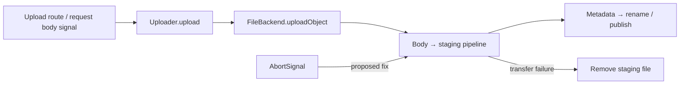

# Storage Engineering Lab

**Follow an upload cancellation signal to the filesystem—and prove where it stops working.** This independent, AI-assisted investigation provides a native before/after reproduction, a small proposed Supabase Storage fix and inspectable regression evidence.

[Case study](reports/file-upload-cancellation.md) · [Real terminal demonstration](evidence/prelaunch/demo-terminal.txt) · [Upstream PR #1616](https://github.com/supabase/storage/pull/1616)

## Problem and root cause

`FileBackend.uploadObject` accepted an `AbortSignal` but omitted it from the pipeline that transfers the request body into a staging file. A cancelled adapter call could continue reading, publish bytes and report success.



The proposed fix rejects pre-aborted calls, passes `{ signal }` into the existing pipeline and normalizes abort errors after cleanup. It changes **8 lines added / 1 removed** in production code; five tests live in the existing upstream test file. [Patch](experiments/fix.patch) · [Tests](experiments/regression.patch)

| Check | Original | Proposed fix |
|---|---|---|
| Already-aborted call | Publishes and succeeds | Rejects before staging |
| Abort during transfer | Source stays live; upload succeeds | Source destroyed; upload rejects |
| Existing adapter destination | Continued transfer replaces bytes | Old bytes preserved; staging removed |
| Abort after body completion | Publication may finish | Publication may finish |
| Five regression/control cases | **2 fail / 3 pass** | **5 pass** |

## Reproduce

Node **24.x** is required. The published review branch has no lab dependencies:

```sh
git clone --branch prelaunch/reproducibility-rc https://github.com/phlppgdfry/storage-engineering-lab.git
cd storage-engineering-lab
npm run check
npm test
```

For the actual native reproduction, first prepare the pinned Storage checkout and native xattr dependency using the [complete setup](docs/reproduction.md), then run:

```sh
npm run doctor -- --checkout ../supabase-storage
node scripts/demo.mjs ../supabase-storage
```

The demo executes real files/xattrs and exact regression red/green checks; full logs remain local. [Captured output](evidence/prelaunch/demo-terminal.txt) · [Troubleshooting](docs/troubleshooting.md). It creates and cleans up its own detached worktree.

## Evidence and limitations

The published candidate records **36 lab tests**, **130 retained measurement groups**, **3,304 Linux unit passes / 2 root-permission skips**, and **1,379 PostgreSQL tests plus five HTTP checks**. These are dated, scoped executions; the [quality gates](reports/quality-gates.md) distinguish them from new local runs and link commands, environment and evidence.

**Normal-upload performance remains inconclusive.** All five timed 4 MiB/concurrency-1 pairs were slower with the fix (median paired throughput observation −16.70%); identical-code controls were unstable. Neither equivalence, a causal slowdown magnitude nor a speedup is established. [Full assessment](reports/performance-final.md).

This proves an adapter cancellation gap. It does not establish hosted-service impact or HTTP data loss. Higher layers normally allocate fresh versions; the overwrite test deliberately reuses an adapter destination. Cancellation after all body bytes arrive may finish publication. Source-thrown `AbortError` normalization also changes without a supplied signal. Known pinned dependency advisories restrict fixtures to disposable local research. [Security](SECURITY.md) · [Audit](reports/audit.md).

## Upstream and project status

Checked **2026-10-30**: [Supabase PR #1616](https://github.com/supabase/storage/pull/1616) is **open, draft and unmerged**, with no returned reviews/comments; upstream CI/Acceptance require approval. No maintainer endorsement is claimed. [Lab PR #1](https://github.com/phlppgdfry/storage-engineering-lab/pull/1) is open and mergeable with successful fast GitHub checks.

This working branch also contains **unpublished experimental research**: download/HTTP cancellation and a bounded synthetic research cycle. A separate [current-upstream GET fix and engineering audit](reports/advanced-engineering.md) records Node 26 validation. The planner evaluation cannot distinguish ordering policies and supports no adaptive-superiority claim. [Current research and review](reports/showcase-review.md) · [Registry](research/hypotheses.json) · [Architecture](docs/architecture.md) · [Interview walkthrough](docs/technical-interview-preparation.md).

[Contributing](CONTRIBUTING.md) · [Release readiness](reports/release-readiness.md) · Apache-2.0; derived patches retain Supabase attribution: [LICENSE](LICENSE), [NOTICE](NOTICE).
