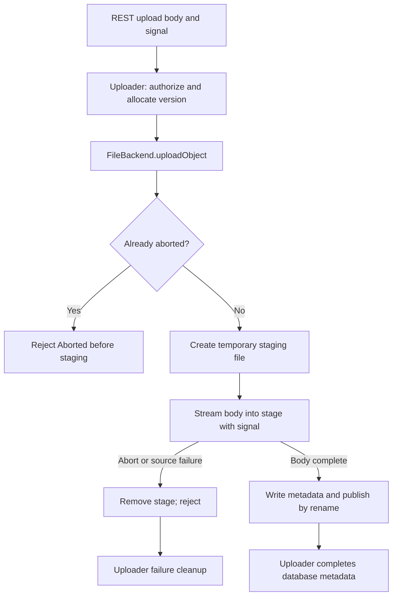

# Architecture and reader paths

This lab investigates one Supabase Storage filesystem-upload cancellation contract. It contains a reproducer, patches and evidence; it is not a storage service or a general benchmark framework. The upstream production commit remains `3bbc971796fe9907a030c4fc70a07d440930d7b2`.

| Reader | Start here | Then inspect |
|---|---|---|
| Developer reproducing the result | [Reproduction](reproduction.md), [troubleshooting](troubleshooting.md) | [Native probe](../experiments/file-upload-cancellation.ts), [regression patch](../experiments/regression.patch) |
| Reviewer assessing correctness | [Case study](../reports/file-upload-cancellation.md), [production patch](../experiments/fix.patch) | [Separate-agent review](../reports/independent-review.md), [current quality gates](../reports/quality-gates.md) |
| Interviewer or portfolio reader | [Engineering impact](../reports/engineering-impact.md) | [Evidence and limits](../reports/completion-2026-10-28.md), [interview preparation](technical-interview-preparation.md) |

## Request and publication lifecycle

The inspected REST create/update routes pass a request-body signal into the uploader. The uploader allocates a backend version, transfers bytes and completes database metadata. The relevant filesystem path stages bytes before publication. This diagram describes the investigated path, not every REST, S3 or multipart operation.

The patch connects the existing signal to the byte-transfer pipeline. Cancellation during transfer destroys the source and rejects with the existing `AbortedTerminate` convention after staging cleanup. Cancellation after the body finishes does not interrupt metadata/publication. The patch reuses the existing staging/rename mechanism; it does not introduce it. See [pinned implementation](https://github.com/phlppgdfry/storage/blob/3bbc971796fe9907a030c4fc70a07d440930d7b2/src/storage/backend/file.ts) and [tests](https://github.com/phlppgdfry/storage/blob/3bbc971796fe9907a030c4fc70a07d440930d7b2/src/storage/backend/file.test.ts).

The old-destination assertion deliberately reuses an adapter key/version. Higher layers normally allocate a fresh version, so that assertion does not establish HTTP-level user-object corruption. Multipart completion calls the adapter without a signal; this change adds no multipart cancellation policy. A source-generated `AbortError` is also normalized to `AbortedTerminate`, even without a supplied signal; the original error is retained.

## Lab boundaries

The lab keeps test orchestration and evidence outside the upstream two-file patch. The native probe exercises actual files, xattrs and the adapter; upstream regression tests use the existing xattr mock. Native and regression results therefore provide complementary evidence.

The supported workflow targets macOS/Linux with Node 24 and an xattr-capable filesystem. Historical executions cover arm64 on both systems; Windows and other architecture/runtime combinations are not established. Optional Linux/integration/benchmark modes require their documented local prerequisites. There is no published npm package or release for this local candidate.

[Historical architecture notes](../research/architecture.md) describe the inspected routes and modules. [Current quality gates](../reports/quality-gates.md) distinguish new RC executions from historical validation. [Tooling comparison](tooling-comparison.md) explains why broad compatibility, traffic-generation and chaos infrastructure should be reused if needed later.
