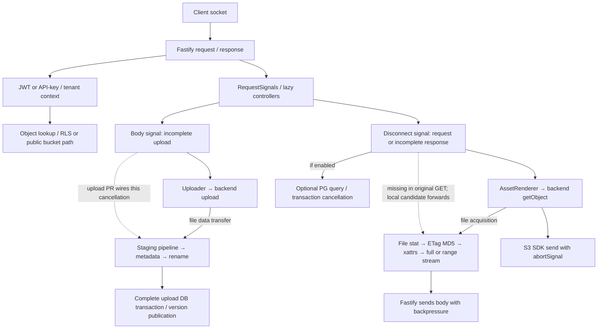

# Advanced Storage engineering assessment — 2026-10-30

**Follow-up 2026-10-31:** the [final closure](final-project-closure.md) records newly executed Linux lab/GET/fixture/HTTP validation, a fresh pinned upload Linux run and release preparation. The dated results and outstanding platform statements below describe the earlier investigation; none of its failed observations are replaced.

**Local work only.** No push, merge, PR-status change, release or maintainer communication. This assessment supersedes earlier current-state statements while retaining their dated evidence. It covers the lab and its associated Storage checkout only.

## Verified inventory and change from handoff

| Item | Verified revision / state |
|---|---|
| Public lab main | `731896020e5e159a85bdf3c51413faa4955d9d6e` |
| Public lab PR#1 | OPEN, non-draft, MERGEABLE, head `4f98bb5861a2df5b0e68cac9a5184bd0f8d744ca`; no returned comments/reviews |
| Prepared presentation-only branch | `showcase/presentation-rc`, `c9006dcd4df099a25b33de26e6281335b5d3db36`, eleven-file delta, local only; no new research code |
| Prior research branch | `research/bounded-cycle`, `9ae5d196f4bc88862dd14f8871880858046a6c3d`; preserved |
| Current lab work | `research/advanced-cancellation`, branched from that clean research HEAD; current exact commit via `git rev-parse HEAD` |
| Original Storage checkout | Clean `fix/file-upload-cancellation` at `3bbc971796fe9907a030c4fc70a07d440930d7b2`; not rebased or edited |
| Latest observed upstream master (frozen review base) | `9d15cdc93c0b1afc37708914f5e45f865b231d48` |
| Initial preserved download branch | `fix/file-download-cancellation`, `e1e033c05c96afd334fe6dee4f7e6d9e0eed4b4f`, based on the initial frozen upstream 211b2beb; two files only |
| Current local download branch | `fix/file-download-cancellation-current`, `8eceb9017690cc4d19ecc47a06452a943b2d0256`, based on 9d15cdc9; same two-file correction |
| Separate test-fixture branch | `test/lifecycle-config-isolation`, `9a760254b942d109054f941b5b21c93d4bd3ffdb`; test-only, not included in the download commit |
| Upstream#1616 | OPEN, DRAFT, MERGEABLE, unmerged, head3bbc9717; no returned reviews/comments/inline comments |

Important difference: upstream advanced from dcbb8eb7 through Node 26 migration #1624, undici8 adaptation #1626 and lifecycle work #1620/#1555. Current engines require Node>=26/npm>=12.2.1. Historical Node 24/old-lock measurements remain historical. Relevant file GET and signal/asset-renderer code were still unchanged, so the finding was not already fixed. A final read-only check found a further advance to9d15cdc9: native env-file loading, lifecycle acceptance/gates and pino/lru-cache updates. The file backend and its test file were unchanged. The initial211 validation was retained; the same correction was independently applied and validated on 9d, then that base was frozen for this review instead of chasing moving master. No CONTRIBUTING/AGENTS/PR-template file was found in the inspected current source tree; source README, SECURITY, package scripts, tests and workflows were inspected. Bounded live searches found #854 still open at aa1adc3d (broad adapter work), #1615's prior HEAD/delete cancellation and no specific completed GET/MD5 correction. This is not an exhaustive novelty claim.

## Architecture and guarantees



Solid arrows describe execution/data flow; dashed arrows identify the separately proposed cancellation connections, rather than claiming original pipelines already honor them. Initial source basis is the immutable [211 tree](https://github.com/supabase/storage/tree/211b2beba30e34f4b365b2c2637c544fc9d444b2). Key paths: `src/http/plugins/{signals,db,storage}.ts`, `src/http/routes/object/{getObject,createObject,updateObject,uploadSignedObject}.ts`, `src/storage/{uploader,object}.ts`, `src/storage/backend/{adapter,file}.ts`, `src/storage/backend/s3/adapter.ts`, `src/internal/database/pg-connection.ts`, `src/storage/protocols/tus/s3-locker.ts`. The later [9d tree](https://github.com/supabase/storage/tree/9d15cdc93c0b1afc37708914f5e45f865b231d48) was reviewed for deltas including `src/config.ts` and `src/internal/env-file.ts`; GET/signal/upload core code remained unchanged. The [download patch](../experiments/download-fix.patch) identifies exact changed code; the [regression patch](../experiments/download-regression.patch) makes its oracle inspectable.

- Request close alone is not failure: RequestSignals checks request `aborted` and response `!writableFinished`. Body and disconnect signals represent different boundaries. Existing `signals.test.ts` checks normal completion, already-closed states and actual socket aborts.
- GET first performs bucket/object authorization. Public bucket retrieval intentionally bypasses object RLS; private retrieval uses caller policies. Only then does the real route pass the disconnect signal into AssetRenderer. The isolated HTTP experiment deliberately bypasses auth/DB lookup and proves no tenant authorization property.
- File GET originally omitted the shared adapter signal. MD5 already supported a signal for HEAD; GET never forwarded one. Renderer checks abort before and after acquisition and destroys a late-acquired body, but that cannot stop earlier hashing. Fastify separately destroys a streamed body on response close.
- REST uploads pass the body signal. Uploader allocates a version after permission checks, then transfers bytes; after complete reception it deliberately installs a fresh DB abort controller so publication can finish. Current uploader/versioning code has replay handling and queues replaced-version deletion after commit. Cancellation is not a universal rollback promise. The adapter same-destination overwrite test is not proof of endpoint data loss.
- S3 GET/PUT/HEAD/delete pass SDK `abortSignal`; multipart Upload has bounded part/queue settings and abort forwarding. Those are source/SDK/mock-test guarantees, not a live-provider outage/retry measurement. `completeMultipartUpload`/provider-managed semantics must not be equated with filesystem staging.
- DB query cancellation is configuration-dependent. `db.ts` attaches disconnect only when enabled; disposal hooks distinguish incomplete bodies and handler-owned leases. `pg-connection.ts` has cancellation/transaction-retry boundaries and tests; full unit passes are not live-PostgreSQL cancellation proof.
- SharedStorageBackend lazily owns the backend and awaits close, clearing its reference first. Forced socket close is exercised here; production process shutdown, graceful-drain races and real remote-provider teardown remain separate validation scopes.

## Confirmed download problem and focused local correction

**Problem/hypothesis:** after an actual client departure before headers, the file backend continues MD5 work because GET drops the signal. The contract is supported by the shared adapter signature, real GET route/AssetRenderer forwarding, cancellable HEAD/MD5 helper and renderer's own abort checks—not by a claim that HTTP itself specifies internal read cancellation.

**Environment:** fresh exact-lock `npm ci` under Node 26.13.0/npm 12.2.1, macOS arm64. Upstream's allowScripts permits fs-xattr and disables the other listed install hooks. Installed tool versions and lock hash are in [summary](../evidence/advanced/summary.json). This installation did not reuse or modify historical Node 24 dependencies. Install scripts are trusted third-party code, not an OS sandbox. No new dependency was added to either project.

**Reproduce before fixing (both frozen bases):** nineteen focused cases on unmodified current upstream produce exactly **10 failures / 9 passes**; controls close any body acquired during the expected red stage. [All failure names and summary](../evidence/advanced/download-red-excerpt.log), raw full buffer diffs retained locally. Tests cover pre-abort for mtime/MD5, cancellation while stat/xattr metadata is gated, MD5 native-open cancellation, acquired full/range streams, repeat aborts, eight success/late-abort controls, an ordinary read-setup failure and composed timeout/caller cancellation preserving the first reason.

**Correction:** ten insertions/four deletions in production (including signature/comment changes), plus nineteen cases in the existing test file. Check `throwIfAborted()` at acquisition boundaries, pass signal to existing ETag/MD5 code, and pass it to both full/range native streams. No new callback/listener framework, dependency, DB/schema, upload or S3 change. Existing ordinary error behavior and conditional/range tests remain intact. Raw pre-abort reason and native stream AbortError/cause follow the existing Node/HEAD conventions; the renderer already recognizes caller reasons and cause chains.

**Tradeoff:** in-flight `stat` and synchronous xattr operations are not cancellable through these APIs. The code checks after awaited work and prevents subsequent acquisition/stream creation. It does not race and abandon an unowned promise or promise instantaneous rejection while an OS operation remains pending. Returned readable streams remain consumer-owned and must have normal stream-error handling. This local correction is more complete than the old two-line diagnostic intervention, but platform/provider and human review gates remain open.

**Initial verification on exact preserved commit e1e033c / base 211:** file suite **171/171**, full upstream unit **3,410/3,410 across180 files**, lint **704 files, no fixes**, TypeScript plus esbuild **PASS**. The final full unit/lint/build runs occurred after committing. [Unit result](../evidence/advanced/unit-final.log), [file tests](../evidence/advanced/green2.log), [lint](../evidence/advanced/lint-final.log), [build](../evidence/advanced/build-final.log). No new PostgreSQL/Linux/container suite is claimed.

## Latest-base validation and lifecycle fixture investigation

The latest candidate `8eceb9017690cc4d19ecc47a06452a943b2d0256` is based on 9d15cdc9, using that lock's fresh Node 26/npm 12 installation. Its unchanged nineteen regression cases again give10 fail/9 pass before the fix. Lint checks708 files and build passes. The first broad candidate run had **3,440 passes/1 failure** in182 files, in `lifecycle-disabled.test.ts`; a single bounded repeat passed **3,441/3,441**. Both results are retained: [first](../evidence/advanced/current-unit-first.log), [repeat](../evidence/advanced/current-unit-rerun.log). A green rerun does not erase the reliability problem.

The untouched9d baseline also fails the same test in the broad suite (**3,421 passes/1 failure**), while its isolated test passes. [Unmodified baseline](../evidence/advanced/lifecycle-baseline-failure.json), [log](../evidence/advanced/lifecycle-baseline-failure.log). A diagnostic-only error observer captured a TypeError reading `lifecycle_configuration` from an undefined fake DB result: the fixture's dynamically mocked disabled configuration did not reliably stop the DB path. [Trace](../evidence/advanced/lifecycle-diagnostic-excerpt.log). The earlier deterministic handler/class-identity hypothesis was not supported and no such patch was committed; [negative result](../evidence/advanced/rejected-isolation-hypothesis.json). `isRenderableError` is duck-typed, so class identity alone is not a defensible explanation.

A separate **test-only** correction uses `vi.stubEnv` and the actual configuration reload API, following neighboring guard tests, rather than dynamically mocking/resetting the module graph. Assertions and production behavior are unchanged. [Patch](../experiments/lifecycle-config-isolation.patch), [record](../evidence/advanced/lifecycle-fixture.json). Its own baseline suite passes **3,422 tests/182 files**, with lint and typecheck. The precise Vitest/CJS/cache/order mechanism remains INCONCLUSIVE; this is a verified fixture mitigation, not a claimed production authorization vulnerability.

Both corrections were then explicitly validated as an overlay, not merged into either branch: **3,441 tests/182 files, lint and build PASS**. [Composite result](../evidence/advanced/composite.json), [actual log](../evidence/advanced/composite-unit.log). The fixture overlay was reversed and the download branch restored clean. This is not evidence that the unmodified latest baseline is green. Future CI/human review must account for the retained failure and keep the one-file fixture change separate from the two-file GET correction. [Current source/lock/exit summary](../evidence/advanced/current-summary.json).

## HTTP, backpressure and resource evidence

The extended worker uses actual Fastify, RequestSignals, AssetRenderer and FileBackend/native xattrs. Original and fixed variants each run three repetitions with nine cases on 211 and again on 9d. The latest exact candidate/baseline records are [original9d](../evidence/advanced/current-http-original.json) and [fixed8eceb9](../evidence/advanced/current-http-fixed.json). Records retain source/worker hashes, event ordering, abort bytes, response metadata, native stream closure, finalization count and worker peak RSS. No artificial file-read throttling/data listener is used to induce the hash observation. The original data remains untouched; [original](../evidence/advanced/http-original.json) and [fixed](../evidence/advanced/http-fixed.json) records support the following scoped findings.

| Case | Actual observation / interpretation |
|---|---|
| Normal full GET | Correct200,16 MiB payload digest/ETag/length; resources close; no false abort |
| Client disconnect before headers | Original abort at 64 KiB, hash finishes16 MiB; fixed stops at 64 KiB in the observed runs |
| Immediately after client sees headers | Zero body bytes delivered to the client; response read stops early and descriptor closes |
| Mid-stream full / range | Correct200/206 and range metadata; partial source reads, closed descriptors |
| Paused consumer | At100 ms,917,504 source bytes read, 64 KiB readable and64 KiB writable queues in both variants; resume completes correctly |
| Near completion | Full server read may already have completed; abort sometimes fires and sometimes does not. Both are consistent with response-finished semantics |
| Forced server socket closure during hash | Original hashes 16 MiB after abort at 0; fixed stops at 0; not a test of full process shutdown |
| Native HEAD control | Actual AbortError/cause path stops read and closes descriptor, preventing an unrelated failure from being counted as cancellation |

Every measured stream eventually closes with `fd === null`; each route finalizes once. This does not establish universal cleanup or an exact cancellation-byte bound. The paused-consumer checkpoint demonstrates backpressure for this fixture, not a maximum-memory proof for arbitrary concurrency. Worker maxRSS is whole-process and descriptive (roughly157–174 MiB in these original three-run samples), not per-request allocation or evidence of a memory improvement. Event times are diagnostics, not a statistically estimated abort/cleanup latency. Client bytes, logical native source bytes and physical disk I/O are different metrics.

## Applicable cancellation/failure matrix

PASS means the named scoped experiment/unit oracle executed; it never upgrades mocks to production observations. Source-only and unexecuted scopes remain explicit.

| Requested scenario | Status and evidence / scope |
|---|---|
| Before headers / after headers / during streaming / near completion | PASS: real HTTP worker above, including normal finish without abort |
| Before storage initialization / already aborted | PASS: new pre-abort tests and existing renderer/signals tests; backend stat not started |
| During retrieval/stat/xattrs | PASS: deterministic gates, rejection after pending operation settles; underlying OS work is not interrupted |
| During hashing | PASS: native HTTP original/fixed and HEAD control |
| During upload | PASS: unchanged patch tested separately on current Node 26 base, red2/green5 and3native probes each variant; [latest9drecord](../evidence/advanced/current-upload.json) (initial211record also retained) |
| Multipart | PASS for existing upstream unit cleanup/error/lease oracles; real S3/TUS provider fault/conformance run NOT EXECUTED |
| Remote-provider cancellation / errors | PASS for existing SDK-forwarding/error mocks in full unit run; real provider behavior NOT EXECUTED |
| DB cancellation / retry | PASS for existing mocked query/transaction/lease tests; real DB cancellation on current baseline NOT EXECUTED |
| Cancellation during final cleanup | Source review only: backend best-effort unlink, uploader queued cleanup and ownership runner cleanup have different contracts. Newly injected FS permission failure during upload cleanup NOT EXECUTED |
| Concurrent/repeated abort / timeout composition | PASS: gated repeated cancellation and first-reason composition; no high-concurrency stress claim |
| Cancellation versus retry | Existing PG/TUS abort-aware retry/sleep tests PASS; no file GET retry loop exists to test |
| Cancellation plus provider error | Existing unit failure cases and ordinary GET read-setup error PASS; real simultaneous remote faults NOT EXECUTED |
| Normal completion / abort after completion | PASS: full/range controls and late-client-close; do not treat completed publication as rollback |
| Server shutdown | PASS for forced local socket closure plus existing backend/pool drain unit oracles; complete service SIGTERM/provider-drain test NOT EXECUTED |

Current uploader catches may await cleanup enqueueing before rethrowing; a queue failure potentially masks a primary transfer failure. File unlink errors are best-effort, so cleanup is not guaranteed under permission/storage failures. These are source-backed risks, not newly reproduced production defects; they should not enlarge either small patch without a focused oracle. Similarly the S3 multipart abort listener deserves a future success-path listener-lifetime test, not an unsupported memory-leak claim.

## Security and research-system trust boundary

**Confirmed lab correctness defect:** an artifact could be swapped to a final-component symlink after realpath/lstat validation but before `readFileSync(path)`. A deterministic owned-fixture test replaces it at the validation boundary; the old reader accepts the outside fixture checksum. [Red](../evidence/advanced/artifact-race-red.log), [green](../evidence/advanced/artifact-race-green.log). The reader now opens with no-follow/nonblocking flags, checks a regular descriptor and hashes bytes from that same descriptor. Memory/record format is unchanged. Full lab tests **45/45 PASS**. This is a local research trust-boundary correction, not a remotely demonstrated Supabase vulnerability.

| Boundary | Assessment |
|---|---|
| Artifact final symlink/FIFO and memory file type | Existing mitigation strengthened by descriptor-based validation/read; tested final replacement and prior dangling-memory cases |
| Parent-directory replacement / malicious same-UID writer | Potential residual risk: portable Node path checks do not provide an openat-style directory capability or defeat an attacker who can rewrite trusted code/private roots. No universal TOCTOU guarantee |
| Object keys | Existing lexical mitigation in secure-path.ts rejects traversal/absolute/null paths; assumes operator-controlled filesystem root. Adversarial on-disk symlink writer and real endpoint exploit NOT TESTED |
| Auth/RLS, tenant isolation, signed URLs | Source boundaries and existing unit controls reviewed; no real multi-tenant penetration test, bypass or new vulnerability claim |
| SSRF/redirects/provider endpoints | Not affected by the proposed file GET change; real redirect/SSRF adversarial tests NOT EXECUTED |
| Child execution / prompt injection | Fixed catalog, no shell command generation, sanitized environment; repository prose cannot become an executable command. Trusted scripts still execute with host privileges |
| Cleanup ownership | Random private owned temp roots, marker checks and existing symlink/process-group/ENOSPC tests; SIGKILL recovery remains manual |
| Logs/artifacts | Synthetic fixtures only, raw local logs ignored; curated records sanitize private paths and have checksums. Redaction is not complete confidentiality certification |
| CI | Lab read-only permissions, pinned actions, no persisted checkout credentials or release job. Hosted untrusted-PR/security guarantees beyond inspected workflow NOT VERIFIED |
| Dependencies | Current exact-lock audit completes exit1:24 affected packages,13 high/11 moderate/0 critical; not 24 CVEs, no exploitability conclusion. [Initial audit](../evidence/advanced/dependency-audit.json) / [latest9daudit](../evidence/advanced/current-dependency-audit.json). No dependency update introduced by patches |

No confirmed remotely exploitable vulnerability was established. No public-infrastructure security tests or vulnerability disclosure was performed.

## Performance and planner conclusions

All original130 measurement groups remain byte-preserved and mechanically validated:50 exploratory,50 timed,30 diagnostic. [Prior assessment](performance-final.md) recalculates their source hashes/arithmetic. B/block 6 fails its retained warm-up rule; passing other warm-up windows does not establish stationarity. Five timed 4 MiB/c1 pairs were slower with median paired throughput observation −16.70%, while identical-code controls were unstable. No predefined valid equivalence margin/precision or independent stable baseline exists. Normal-upload neutrality, causal slowdown magnitude and throughput gain remain **INCONCLUSIVE**. Repeating noisy throughput samples to obtain a favorable result is rejected.

Current logical reads and closure/backpressure observations are functional evidence, not throughput benchmarks. No generalized I/O saving, latency percentile, CPU saving, memory reduction or production impact is claimed. A fresh stable-host identical-code calibration and predeclared workload/margin/analysis are prerequisites for a new equivalence study.

The planner's frozen v1 corpus has balanced duplicated one-probe mutants under a two-probe budget. All six rankings necessarily yield 4/6,14 experiments and mean detection index 1.5; sample duplication and scoring symmetry make comparative effectiveness non-identifiable. Existing evaluator explicitly reports NONDISCRIMINATING. [Actual matrix](../evidence/showcase/evaluation.json). There is no evidence of adaptive superiority or general equivalence. Keep fixed by default. A versioned independent, diverse/cost-sensitive or stateful corpus would be justified only by a real planner use case; do not tune frequencies to favor the current heuristic. No model retraining, novel experiment generation or autonomous publication exists.

## CI, publication units and final decisions

Actual hosted lab head 4f98bb5 [push check](https://github.com/phlppgdfry/storage-engineering-lab/actions/runs/40810513903) and [PR check](https://github.com/phlppgdfry/storage-engineering-lab/actions/runs/40810518097) are SUCCESS. These do not cover c9006dc, the new lab branch, e1e033c,8eceb9or9a76025. Hosted CI for every new local commit is **NOT EXECUTED**, because publication is unauthorized. Upstream#1616 [CI](https://github.com/supabase/storage/actions/runs/40587294139) and [Acceptance](https://github.com/supabase/storage/actions/runs/40587294201) remain action_required; title lint is successful. No human reviewer feedback is returned.

| Decision | Assessment / condition |
|---|---|
| Lab | **CONDITIONAL GO**: the existing presentation-only branch is locally reviewable; approve its scoped push, observe hosted CI on that head, approve merge separately |
| Upload#1616 | **CONDITIONAL GO** for focused maintainer review, not production/performance clearance. Patch remains separate/minimal; upstream CI/human review outstanding |
| Download contribution | **CONDITIONAL GO** for reviewing the separate local two-file candidate. No new PR without approval; current Linux/real-DB/provider matrix and human review remain unexecuted |
| Agent self-improvement claims | **UNSUPPORTED**; comparative adaptive benefit **INCONCLUSIVE** with current nondiscriminating corpus |

Publication paths must stay separate:

1. Lab PR update: review `git diff prelaunch/reproducibility-rc...showcase/presentation-rc`; after explicit approval only, ordinary fast-forward push to the existing PR branch. Observe actual hosted checks on its exact new head. Do not include the broader research branch.
2. Lab PR merge: requires separate approval after that check; no auto-merge/force push.
3. Existing upstream PR: no justified production change identified; do not rebase, push, mark ready or message maintainers automatically. Frozen-base compatibility probes are supporting evidence, not new approval.
4. Potential GET PR: inspect local `fix/file-download-cancellation-current` and the two patches; obtain separate publication approval. Draft description below is local only.
5. Lifecycle fixture correction: one-file branch9a76025 remains separate; do not automatically open another PR or bundle it into GET. Share/submit only after explicit approval and review.
6. Research-only lab work: artifact-reader hardening, HTTP matrix and audit remain on the local advanced branch, outside PR#1 until independently scoped/approved.

### Local maintainer-facing draft (not posted)

`FileBackend.getObject` drops the existing optional AbortSignal: disconnecting before headers does not stop an in-flight MD5 read, and returned full/range readers do not observe direct caller cancellation. The current-native HTTP repro records abort at 64 KiB while 16 MiB still gets read. Forward the signal to existing MD5/native read streams and check cancellation between awaited acquisition steps. Existing no-signal/range/conditional behavior remains covered; no upload, S3, database or dependency change.

Nineteen focused cases fail10/pass9 before and pass after; the full file suite passes171 tests. On the latest frozen9d baseline the first full candidate run had3440 passes/1 lifecycle-fixture failure; a bounded repeat passed3441/182 files. Untouched9d reproduced that failure. A separate test-only fixture mitigation passes3422 baseline tests, and an explicitly reversible combined overlay passes3441 plus lint/build. These retained results do not claim an always-green baseline. Actual original/fixed HTTP cases cover headers, streaming, paused clients, late close and forced socket close, with descriptors closed. In-flight stat/xattr cannot be interrupted through these APIs; no general speed/resource or hosted-impact claim. Linux/DB/provider conformance and human review remain separate gates. AI assistance was used; the reported checks were executed locally and do not imply maintainer acceptance.

## Reproduce the new candidate without touching historical checkouts

Use a new non-existing disposable clone path and the current Node 26/npm 12 engine requirements. Do not copy private credentials/configuration. These are the same underlying operations actually exercised in the owned validation environment:

```sh
git clone https://github.com/supabase/storage.git ../storage-download-check
cd ../storage-download-check
git switch --detach 9d15cdc93c0b1afc37708914f5e45f865b231d48
node --version  # observed26.13.0; current upstream requires>=26
npm --version   # observed12.2.1; current upstream requires>=12.2.1
npm ci --no-audit --no-fund
cp .env.sample .env
cp .env.test.sample .env.test
git apply ../storage-engineering-lab/experiments/download-regression.patch
node node_modules/vitest/vitest.mjs run --config vitest.unit.config.ts src/storage/backend/file.test.ts -t 'FileBackend getObject signal'
# Expected red: exit1,10 failed/9 passed. Inspect it; do not treat an infrastructure failure as red.
git apply ../storage-engineering-lab/experiments/download-fix.patch
node node_modules/vitest/vitest.mjs run --config vitest.unit.config.ts src/storage/backend/file.test.ts
npm run lint
npm run build
npm run test:unit
# Retain any lifecycle-disabled failure; it also occurred on untouched9d.
# To test the separate fixture mitigation explicitly (no production change):
git apply ../storage-engineering-lab/experiments/lifecycle-config-isolation.patch
npm run test:unit
# Optional actual minimal-route HTTP check on the fixed variant, with a clean ambient environment:
env -i PATH="$PATH" TMPDIR=/tmp NODE_ENV=test node node_modules/tsx/dist/cli.mjs --tsconfig tsconfig.json ../storage-engineering-lab/experiments/http-download-cancellation.ts . forwarded extended
```

Use the original source without the fix and `original extended` to reproduce the baseline HTTP behavior. Preserve raw logs from both variants. The existing historical upload quickstart/demo remains Node 24/pinned old source; it is intentionally not redirected to moving master.

## Ranked outstanding work

P0: no newly known blocking defect remains in the exercised local scope; no universal security certification. P1: review the separate lifecycle fixture mitigation and explain/track the baseline suite reliability issue; authorize and inspect hosted review of the prepared presentation-only update; obtain human/CI review of upload#1616; independently review the separate GET patch and execute the relevant Linux/CI matrix before relying on it for release. P2: a focused queue-cleanup-error preservation oracle or S3 multipart listener-success oracle, selected by actual upstream value; no competing patch without reproduction/overlap review. P3: stable-host performance equivalence and a genuinely discriminating planner evaluation only with a real decision/use case and fixed predeclared method. REJECT: more infrastructure, additional dependencies, synthetic performance publicity, automatic outreach or a general autonomous platform.
