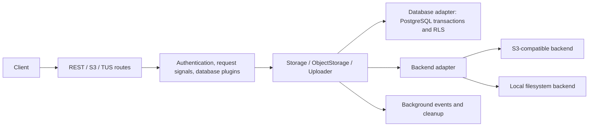

# Architecture notes

Scope: selected request paths and test infrastructure at `4134dbba`; not a complete audit.

## Files inspected

- `src/start/server.ts`: startup, shutdown dependencies, migrations, queue and database pool setup.
- `src/storage/storage.ts`: combines a backend, database and object locator; creates object operations and renderers.
- `src/storage/object.ts`: copy creates a fresh backend version, then writes the database row; account for this before claiming that a backend-copy failure corrupts a published object.
- `src/storage/uploader.ts`: authorizes, generates a version, uploads bytes and completes database metadata. Failed uploads schedule backend cleanup. Completion intentionally continues after bytes are received even if the client disconnects.
- `src/http/routes/object/createObject.ts` and `updateObject.ts`: pass the request-body cancellation signal into upload.
- `src/http/plugins/signals.ts`: body, response and disconnect signals have distinct lifecycles.
- `src/storage/backend/adapter.ts`: shared backend contract includes optional upload and read cancellation signals.
- `src/storage/backend/file.ts`: filesystem operations, staging for upload and multipart parts, metadata through extended attributes, ETag calculation and conditional reads.
- `src/storage/backend/s3/adapter.ts`: S3 SDK implementation, explicit upload cancellation handling.
- `src/storage/renderer/renderer.ts`: download headers, cache behavior and error conversion.

## Testing

Unit tests live beside production modules and use `vitest.unit.config.ts`. Database and service integration tests live in `src/test` and use `vitest.integration.config.ts`. Existing file-backend tests use real temporary files and mock filesystem extended attributes; any new tests using that setup must disclose this boundary.

Docker infrastructure is in `.docker/docker-compose-infra.yml`, including PostgreSQL, PgBouncer, RustFS, imgproxy and Iceberg. Reuse it when needed. Do not run `infra:restart` against an unrelated existing stack.

## Contribution conventions

`README.md` documents development, tests and Biome. The PR-title workflow checks semantic titles. Root `LICENSE` is Apache-2.0, although package.json currently labels the package ISC; treat copied source under the actual root license and preserve notices. No source is copied into this lab by default.

Maintainer priorities inferred from recent commits include safe file publication, deletion retries and cancellation. These are observations about recent work, not an official roadmap.
